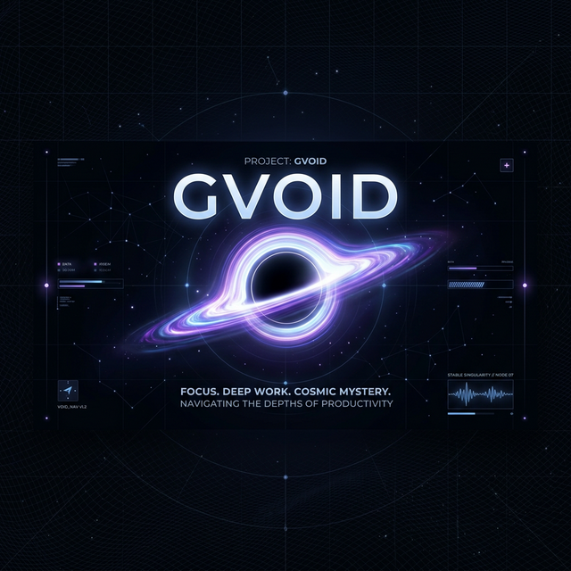

<p align="center">
  
</p>

<h1 align="center">GVOID</h1>

<p align="center">
  <strong>A deep work station: Pomodoro timer, ambient sound, tasks, and focus stats in one draggable layout.</strong>
</p>

<p align="center">
  
  
  
  
</p>

<p align="center">
  <a href="https://gvoid.vercel.app/">Live demo</a>
</p>

## Overview

GVOID is a focus app built around a Pomodoro timer. The timer, task list, ambient audio, and a small visual called the Void are separate widgets that you arrange on a grid, and the layout is saved in your browser. Finishing sessions earns XP, which you can spend in a skill tree, so the app also doubles as a small game about staying on task.

Everything runs client-side. There is no account and no backend; settings, stats, and layout live in `localStorage`.

## Features

- **Pomodoro timer.** Adjustable intervals, optional auto-start for breaks and for the next session, and the remaining time in the browser tab title.
- **Current Focus.** A task list with a choice of completion sound (temple bell, crystal chime, or wood tap).
- **Ambient sound.** Six streams: Lo-Fi, Rain, Brown noise, House, Breakcore, and Fog. Audio plays from YouTube, so it needs a network connection.
- **Modular layout.** Drag and resize widgets with React Grid Layout, and switch modules on or off from the modules menu.
- **Stats.** Total focus time, focus efficiency, per-session breakdowns, and a session heatmap.
- **Progression.** XP, a global XP bar, and a skill tree of small upgrades.
- **Themes.** 14 color themes, including Deep Focus, Event Horizon, Retro Terminal, Nebula Mist, and Frozen Moon.
- **Terminal.** A built-in command line for checking status, switching themes (`theme event-horizon`), and controlling music (`music set rain`). Run `help` to see the rest.

## Running locally

You need Node.js 18 or newer.

```bash
git clone https://github.com/SketchyRock/Gvoid.git
cd Gvoid
npm install
npm run dev
```

Then open `http://localhost:5173`.

Other scripts:

```bash
npm run build    # production build in dist/
npm run preview  # serve the production build locally
npm run lint     # ESLint
```

## Tech stack

- [React 19](https://react.dev/) for the UI
- [Vite 7](https://vitejs.dev/) for dev server and builds
- [Tailwind CSS 3](https://tailwindcss.com/) for styling
- [React Grid Layout](https://github.com/react-grid-layout/react-grid-layout) for the draggable widget grid
- [React Player](https://github.com/cookpete/react-player) for audio playback
- [Framer Motion](https://www.framer.com/motion/) for animation

## License

MIT. See [LICENSE](LICENSE).
